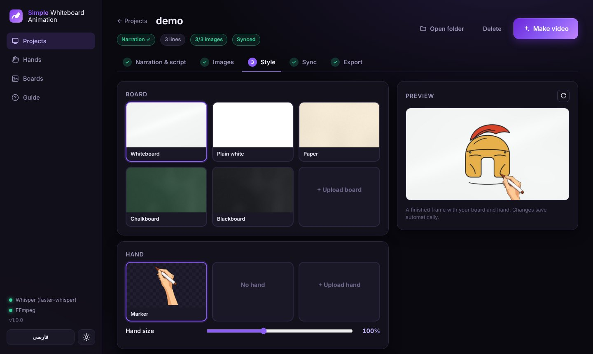

<div dir="rtl">

<p align="center">
  
</p>

<h1 align="center">Simple Whiteboard Animation</h1>

<p align="center">
  <b>نریشن + اسکریپت + تصویرها ← ویدیوی وایت‌برد دست‌کشیده، هماهنگ با تک‌تک خط‌ها.</b><br>
  روی کامپیوتر خودتان اجرا می‌شود؛ بدون اشتراک و بدون مدل تصویرساز پولی.
</p>

<p align="center"><a href="README.md">English</a></p>

<p align="center">
  
</p>

## این برنامه چه کار می‌کند؟

سه چیز آپلود می‌کنید:

۱. **نریشن** (MP3، WAV، M4A و …)<br>
۲. **اسکریپت**، هر خط برای یک تصویر: `1. زندگی به سبک اسپارتی.`<br>
۳. **تصویرها** با اسم شماره‌ی خط: `1.png`، `2.png` … `300.png` (PNG، JPG، WebP یا SVG)

ویسپر به نریشن گوش می‌دهد و لحظه‌ی دقیق گفته‌شدن هر خط را پیدا می‌کند. وقتی خط ۵۸ شروع می‌شود، دست شروع به کشیدن تصویر ۵۸ می‌کند: اول خط‌ها، بعد رنگ. قلم وقتی گوینده حرف می‌زند حرکت می‌کند و در مکث‌ها آرام می‌شود. بعد تخته عوض می‌شود و طراحی بعدی شروع می‌شود. خروجی یک فایل MP4 همراه با صدای شماست.

<p align="center"></p>

## امکانات

- **کشیدن هماهنگ با صدا**: هر تصویر با اولین کلمه‌ی خط خودش شروع می‌شود (زمان‌بندی کلمه‌به‌کلمه‌ی ویسپر که با متن اسکریپت شما تطبیق داده می‌شود، پس اشتباه‌های تشخیص گفتار مهم نیست)
- **قلم طبیعی**: خطوط تصویر به مسیر واقعی قلم تبدیل می‌شوند؛ دست روی همان مسیر حرکت می‌کند، بین خط‌ها بلند می‌شود و بعد رنگ می‌زند. تصویرهای SVG دقیقاً روی مسیر خودشان کشیده می‌شوند
- **تخته‌ها**: وایت‌برد، سفید ساده، کاغذ، تخته سبز، تخته سیاه یا تصویر دلخواه شما. روی تخته‌های تیره، خط‌های تیره خودکار گچی می‌شوند
- **دست‌ها**: دست ماژیک‌به‌دست پیش‌فرض، یا هر تعداد دست دلخواه به‌صورت PNG؛ فقط روی نوک قلم کلیک کنید
- **سبک‌ها**: اول خط بعد رنگ، کشیدن رنگی، یا فقط خط؛ جابه‌جایی اسلاید، محو، پاک‌کردن یا قطع
- **قالب‌ها**: ۱۶:۹ یوتیوب، ۹:۱۶ شورتس و ریلز، ۱:۱ و ۴:۵؛ از 720p تا 4K؛ ۲۴، ۳۰ یا ۶۰ فریم
- **کنترل دقیق**: زمان شروع و پایان هر خط را تغییر دهید، صدای هر خط را پخش کنید یا فقط پیش‌نمایش یک خط را بسازید
- **فارسی و انگلیسی**: محیط برنامه بین English و فارسی (راست‌به‌چپ) عوض می‌شود؛ نریشن و اسکریپت فارسی پشتیبانی می‌شود
- **آفلاین**: همه‌چیز روی سیستم خودتان اجرا می‌شود. اینترنت فقط یک بار برای نصب اجزا لازم است
- **سازگار با Claude Code**: پروژه‌ها پوشه‌های ساده هستند و Claude Code می‌تواند همه‌ی تصویرهای SVG را برایتان بکشد

## شروع سریع

به **پایتون 3.10 یا جدیدتر** و **FFmpeg** نیاز دارید. ویسپر اختیاری است ولی برای همگام‌سازی دقیق توصیه می‌شود.

| سیستم | روش اجرا |
|---|---|
| **ویندوز** | روی **`Start-Windows.bat`** دوبار کلیک کنید |
| **مک** | روی **`Start-Mac.command`** دوبار کلیک کنید (بار اول: کلیک راست ← Open) |
| **لینوکس** | دستور `./start.sh` را اجرا کنید |

اجرای اول یک محیط اختصاصی آماده می‌کند (فقط یک بار و نیاز به اینترنت دارد). از آن به بعد برنامه مستقیم در مرورگر با آدرس `http://127.0.0.1:7860` باز می‌شود. برای بستن، پنجره‌ی سیاه را ببندید.

این محیط بسته‌هایی را که قبلاً نصب کرده‌اید می‌بیند، پس ویسپری که از قبل دارید همان‌طور استفاده می‌شود. اگر ویسپر ندارید:

<div dir="ltr">

```bash
pip install faster-whisper
```

</div>

نکته: روی `Start-Windows.bat` کلیک راست کنید ← *Send to ← Desktop (create shortcut)* تا یک آیکون یک‌کلیکی روی دسکتاپ داشته باشید.

## روند کار

۱. **نریشن و اسکریپت**: صدای نریشن را آپلود کنید و اسکریپت را بچسبانید. خط‌های شماره‌دار (`1.` `2)` `[3]` `4 -`) یا هر خط در یک سطر. اعداد فارسی هم قبول است.<br>
۲. **تصویرها**: همه‌ی تصویرها را یک‌جا (یا به‌صورت ZIP) بکشید و رها کنید. عدد داخل اسم فایل، خط آن را مشخص می‌کند: `7.png`، `007.jpg` و `scene_7.png` همه مال خط ۷ هستند. تصویرهای جاافتاده مشخص می‌شوند و در آن خط، تصویر قبلی روی صفحه می‌ماند.<br>
۳. **ظاهر**: تخته، دست و اندازه‌اش، سبک کشیدن، ریتم قلم، زمان کشیدن، جابه‌جایی، قالب و کیفیت. پیش‌نمایش زنده ظاهر نهایی را نشان می‌دهد.<br>
۴. **همگام‌سازی**: *ویسپر* (دقیق)، *وارد کردن SRT* (زمان‌بندی زیرنویسی که دارید) یا *تخمینی* (پیش‌نویس سریع). بعد هر خط را در جدول زمانی دقیق کنید، پخشش کنید یا فقط از همان خط پیش‌نمایش بسازید.<br>
۵. **خروجی**: فایل MP4 را بسازید (کیفیت بالا یا پیش‌نویس سریع) و دانلود کنید.

یا دکمه‌ی **ساخت ویدیو** را بزنید تا همگام‌سازی (در صورت نیاز) و ساخت ویدیو با یک کلیک انجام شود.

### برای بهترین نتیجه

- طرح خطی تمیز روی پس‌زمینه‌ی سفید ساده طبیعی‌ترین حالت را دارد. PNG شفاف هم خوب کار می‌کند.
- عکس‌های شلوغ هم کار می‌کنند ولی به‌صورت یک تصویر کامل کشیده می‌شوند.
- **زمان کشیدن** تعیین می‌کند چه سهمی از هر خط صرف کشیدن شود؛ بقیه‌اش تصویر کامل نمایش داده می‌شود. **بیشترین زمان کشیدن** برای خط‌های خیلی طولانی سقف می‌گذارد.
- **ریتم قلم ← همراه صدا** قلم را هنگام گفته‌شدن کلمات حرکت می‌دهد و در مکث‌ها آرام می‌کند. **سرعت ثابت** یکنواخت می‌کشد.
- برای ویدیوهای فارسی **ترتیب کشیدن ← راست به چپ** را انتخاب کنید (حالت خودکار برای اسکریپت فارسی همین کار را می‌کند).

## Claude Code تصویرها را بکشد

تصویرساز ندارید؟ چون پروژه‌ها پوشه‌های ساده هستند، یک دستیار برنامه‌نویسی هوش مصنوعی می‌تواند تصویرها را به‌صورت طرح خطی SVG بکشد؛ این طبیعی‌ترین نوع ورودی برای قلم هم هست.

۱. در برنامه پروژه را بسازید و نریشن و اسکریپت را اضافه کنید.<br>
۲. پوشه‌ی این برنامه را در [Claude Code](https://claude.com/claude-code) باز کنید و بنویسید:

<div dir="ltr">

> Draw the images for the project "my-video".

</div>

۳. Claude Code اسکریپت را می‌خواند و طبق [`docs/svg-style-guide.md`](docs/svg-style-guide.md) فایل‌های `images/1.svg`، `images/2.svg` و … را می‌سازد و کار خودش را با `python -m swa lint-svg` و یک برگه‌ی نمایه (`python -m swa sheet`) بررسی می‌کند.<br>
۴. برگردید به برنامه: **همگام‌سازی ← خروجی**.

می‌توانید منابع را ترکیب کنید: برای بعضی خط‌ها PNG خودتان و برای بعضی SVG.

## دست‌ها و تخته‌ها

- **دست‌ها** (منوی کناری ← دست‌ها): عکس PNG یک دست که خودکار، ماژیک یا گچ گرفته را آپلود کنید؛ بهتر است پس‌زمینه شفاف باشد و ساعد تا لبه‌ی پایین تصویر ادامه پیدا کند. روی نوک قلم کلیک کنید و اندازه را تنظیم کنید. هر تعداد دست که بخواهید آپلود کنید و برای هر پروژه یکی را انتخاب کنید.
- **تخته‌ها** (منوی کناری ← تخته‌ها): هر تصویری را به‌عنوان تخته‌ی دلخواه آپلود کنید. تصویرهای تیره خودکار طراحی‌ها را گچی می‌کنند.

## خط فرمان

همه‌ی کارهای برنامه از ترمینال هم انجام می‌شود:

<div dir="ltr">

```bash
python -m swa                          # اجرای برنامه
python -m swa new "The Spartan Way"    # ساخت پروژه
python -m swa check the-spartan-way    # چه چیزی کم است؟
python -m swa align the-spartan-way    # همگام‌سازی با ویسپر
python -m swa render the-spartan-way --line 12 --draft   # پیش‌نمایش سریع یک خط
python -m swa render the-spartan-way   # ویدیوی کامل
python -m swa sheet the-spartan-way    # برگه‌ی نمایه‌ی همه‌ی طراحی‌ها
python -m swa lint-svg the-spartan-way # بررسی طرح‌های SVG
```

</div>

## رفع مشکلات

| مشکل | راه‌حل |
|---|---|
| «FFmpeg پیدا نشد» | FFmpeg را نصب کنید و مطمئن شوید دستور `ffmpeg` در ترمینال کار می‌کند، یا متغیر `FFMPEG` را روی مسیر کامل `ffmpeg.exe` بگذارید. |
| «ویسپر پیدا نشد» | دستور `pip install faster-whisper` را با همان پایتونی که برنامه را اجرا می‌کند بزنید، یا از *SRT* / *تخمینی* استفاده کنید. |
| ویسپر کند است | در تب همگام‌سازی مدل کوچک‌تر (`base` یا `small`) انتخاب کنید. برای فارسی `medium` یا `large-v3` دقیق‌ترند. |
| یک طراحی زود یا دیر شروع می‌شود | تب همگام‌سازی ← زمان شروع آن خط را تغییر دهید ← *ذخیره‌ی زمان‌ها*. |
| قلم از جای اشتباهی روی دست شروع می‌کند | دست‌ها ← *نوک قلم* ← دقیقاً روی نوک کلیک کنید. |

## مجوز

MIT؛ فایل [LICENSE](LICENSE) را ببینید.

</div>
